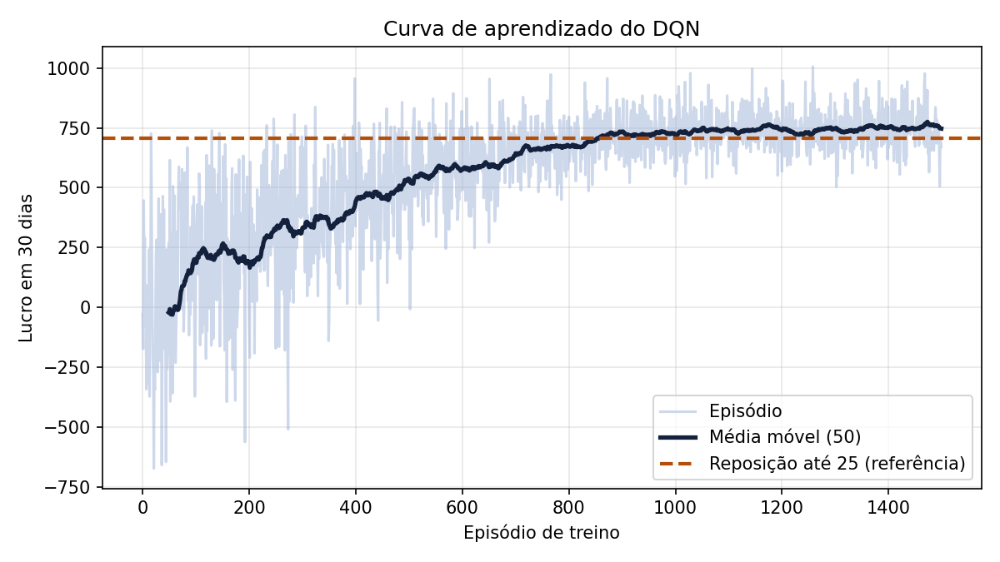
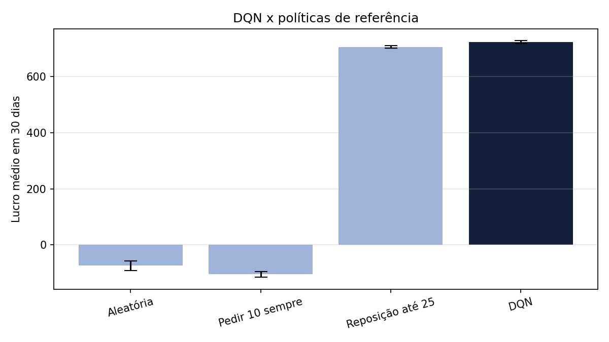
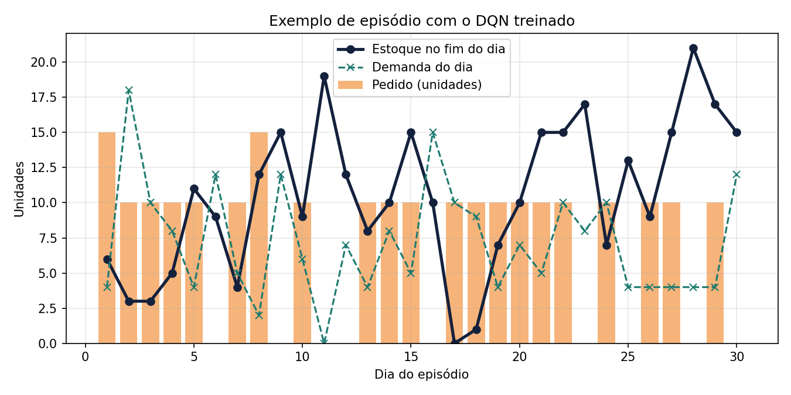

# Desafio 1 – Gerenciamento de Estoque com DQN

Caio Couto Soares (12021BCC004) · Estevão Lorena Amorim (12511BCC044)

## O problema (MDP)
Uma loja vende um único produto. Todo dia o agente decide quanto pedir ao fornecedor.

| Elemento | Definição |
|---|---|
| Estado | (estoque atual, pedido a caminho, dia da semana) |
| Ações | pedir 0, 5, 10, 15 ou 20 unidades (o pedido chega no dia seguinte) |
| Recompensa | +10 por unidade vendida, −6 por unidade pedida, −0,5 por unidade em estoque no fim do dia, −4 por unidade que faltou |
| Demanda | Poisson, com média diferente em cada dia da semana (5, 5, 6, 6, 8, 12, 10 de segunda a domingo) |
| Episódio | 30 dias; capacidade máxima de 50 unidades |

O estado é markoviano: estoque, pedido a caminho e dia da semana bastam para decidir, sem olhar o histórico.

## O DQN
- Rede neural com 2 camadas ocultas de 64 neurônios (entrada: 9 valores; saída: um valor Q por ação)
- Replay buffer de 20 000 transições, rede alvo atualizada a cada 250 passos
- Política epsilon-greedy, com epsilon caindo de 1,0 para 0,05
- 1500 episódios de treino

## Resultados
Lucro médio em 30 dias, em 300 episódios de avaliação, com as mesmas sequências de demanda para todas as políticas:

| Política | Lucro médio |
|---|---|
| **DQN** | **724** |
| Reposição até 25 | 707 |
| Aleatória | −74 |
| Pedir 10 sempre | −105 |





Os números completos estão em `resultados/resultados.json`.

## Arquivos
- `estoque_env.py`: ambiente (`reset`, `step`) e políticas de referência
- `dqn.py`: rede Q, replay buffer, rede alvo e epsilon-greedy (PyTorch)
- `treinar.py`: treina, avalia e gera os gráficos
- `graficos.py`: curva de aprendizado, comparação e episódio de exemplo
- `desafio-estoque-dqn.ipynb`: o mesmo código em um único notebook, para rodar no Google Colab
- `resultados/`: gráficos e números da execução

## Como rodar
```bash
pip install -r requirements.txt
python treinar.py                  # 1500 episódios (alguns minutos em CPU)
python treinar.py --episodios 2000 --semente 1
```
Ou abra o notebook `desafio-estoque-dqn.ipynb` no Google Colab e use **Ambiente de execução → Executar tudo**.
